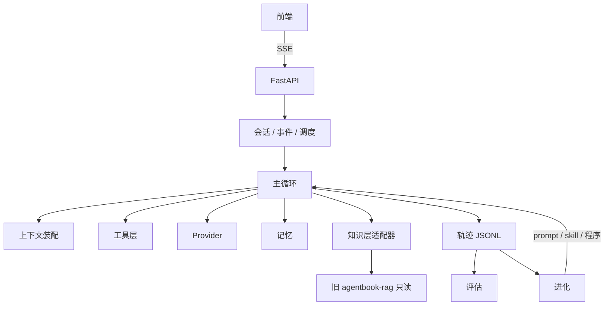

# 架构

> **现状：仅 `knowledge/` 已实现；下表为目标态（M1 起落地）。**
> 不要把下表当成现有代码来读——`src/aide/`、`web/` 目前还不存在。

## 一、六个格子

书稿第 1 章给出的公式是全项目唯一的分层依据：

```
Agent = LLM + 上下文 + 工具
生产形态 Agent = Model + Harness
Harness = 上下文管理 + 工具接口 + 约束 + 验证 + 纠正
```

| 格子 | 本仓库落点 |
|---|---|
| LLM | `src/aide/llm/` |
| 上下文 | `core/context.py`、`core/state_bar.py`、`core/compressor.py`、`memory/`、`knowledge/` |
| 工具 | `src/aide/tools/` |
| 约束 | `core/loop.py`、`core/policy.py` |
| 验证 | `src/aide/eval/`、`core/verifier.py` |
| 纠正 | `src/aide/evolution/` |

## 二、依赖方向

```
llm → core → tools / memory / knowledge → runtime → apps → api → web
```

下层不反向依赖上层。`eval` 与 `evolution` 只通过轨迹与配置读写与主链路耦合，因此可以独立测试与单独运行。

## 三、数据流



## 四、知识层为什么是"适配器"而不是"重写"

旧包没有 `pyproject.toml`，不能被声明为 PEP 508 路径依赖。`knowledge/loader.py` 通过 `AIDE_RAG_HOME` 注入 `sys.path`，沿用旧项目 `backend/app/agentbook_rag.py` 已有的桥接方式。代价是多一层间接；收益是旧包 37 个测试与既有评估基线零影响，且迁移时机可以独立决定。

## 五、已知技术债（继承自旧项目，本仓库不修）

1. 旧 `/api/chat` 是全文注入，不是 RAG —— 本仓库用统一语料替代，不再走全量注入。
2. 旧包无流式、无服务端会话状态 —— 由 M1 的 SSE 层补齐。
3. 旧仓库存在嵌套重复目录 `个人网站/个人网站/agentbook-rag/` —— 不在本仓库范围内。
